# Bitácora Técnica Integral — Segundo Corte (VLFisioterapia)

- **Proyecto:** VLFisioterapia · Centro Integral de Fisioterapia y Rehabilitación
- **Curso:** Electiva 2 (Creación de Chatbots) · Periodo EAM-2026II
- **Equipo:** `Equipo_Sheen_castaneda_vargas`
- **Integrantes y roles:**
  - **Victor Sheen Arias Zuleta** — Cabecilla / Arquitecto
  - **Valentín Castañeda Marín** — Observadora / QA
  - **Samuel Rojas Vargas** — Mano Derecha / Backend Lead
- **Fecha de corte documental:** 2026-10-22

---

## 1. Contexto y alcance

### 1.1 Problema del negocio y usuarios objetivo
En un centro de fisioterapia y rehabilitación física (**VLFisioterapia**, ubicado ficticiamente en Armenia, Quindío), la recepción manual de solicitudes de valoración y sesiones terapéuticas genera demoras de atención fuera del horario de oficina, pérdida de turnos cuando un paciente cancela sin liberar la agenda a tiempo, y posibles cruces de horario cuando varios especialistas atienden distintos tratamientos en paralelo.

Los **usuarios objetivo** son:
1. **Pacientes de la clínica:** personas que desean conocer el catálogo de tratamientos, tarifas en pesos colombianos (COP) y horarios disponibles, o bien agendar, consultar, reprogramar o cancelar una cita expresándose en lenguaje natural a lo largo de varios mensajes.
2. **Personal administrativo y fisioterapeutas:** responsables de que ninguna cita se registre fuera del horario laboral, que se respete la duración real de cada terapia (45 o 60 minutos) y que no se solapen dos pacientes con el mismo profesional en el mismo intervalo.

### 1.2 Alcance funcional y límites del chatbot
- **Dentro del alcance:**
  - Consultar los 6 tratamientos fisioterapéuticos del catálogo ([`clinica.json`](../clinica.json)): `evaluacion` (60 min, $80.000 COP), `deportiva` (45 min, $70.000 COP), `traumatologica` (45 min, $65.000 COP), `puncion_seca` (45 min, $75.000 COP), `postural` (45 min, $60.000 COP) y `neurologica` (60 min, $85.000 COP).
  - Consultar disponibilidad de horarios en pasos de 30 minutos para una fecha y servicio dados, filtrando por fisioterapeuta (`mariana`, `carlos`, `valeria`) o unificando los turnos libres de los especialistas habilitados.
  - Completar datos de una solicitud en **múltiples turnos de conversación** (acumulando cliente, servicio, fecha, hora o código de cita).
  - Crear (`POST /citas`), consultar (`GET /citas/{codigo}`), modificar/reprogramar (`PATCH /citas/{codigo}/reprogramar`) y cancelar (`DELETE /citas/{codigo}?confirmado=true`) reservas persistidas en **SQLite** (`reservas.db`).
  - Exigir **confirmación explícita** antes de ejecutar cualquier operación de escritura (creación, modificación o cancelación), permitiendo descartar la solicitud pendiente o reiniciar la conversación sin afectar las reservas guardadas.
- **Fuera del alcance (límites estrictos):**
  - El asistente **no realiza diagnósticos médicos**, no interpreta radiografías ni prescribe medicamentos.
  - No atiende urgencias hospitalarias vitales ni fracturas abiertas; ante preguntas ajenas al centro responde con la acción `fuera_de_alcance` indicando las capacidades permitidas.

---

## 2. Arquitectura y archivos del proyecto

### 2.1 Diseño en cuatro capas desacopladas
El sistema separa estrictamente la interfaz de usuario, la interpretación probabilística del lenguaje natural, las reglas transaccionales del negocio y el motor de almacenamiento relacional:

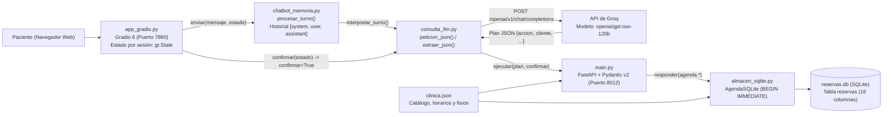

### 2.2 Responsabilidad de cada archivo del repositorio

| Archivo | Capa | Funciones / Clases clave | Responsabilidad técnica |
|---|---|---|---|
| [`app_gradio.py`](../app_gradio.py) | Interfaz web (Gradio 6) | `nuevo_estado()`, `enviar()`, `confirmar()`, `descartar()`, `reiniciar()`, `crear_interfaz()` | Renderiza el chat en `http://127.0.0.1:7860`, mantiene el estado aislado por pestaña mediante `gr.State`, bloquea envíos si hay una operación pendiente de confirmar y muestra el historial JSON de depuración. |
| [`chatbot_memoria.py`](../chatbot_memoria.py) | Memoria conversacional | `INSTRUCCIONES`, `nuevo_historial()`, `interpretar_turno()`, `procesar_turno()` | Construye el historial iniciado con el rol `system` y la fecha actual, envía toda la secuencia `messages` a Groq y registra el resumen `{plan, respuesta}` como mensaje `assistant`. |
| [`consulta_llm.py`](../consulta_llm.py) | Cliente LLM y cliente HTTP de negocio | `cargar_env()`, `peticion_json()`, `extraer_json()`, `normalizar_servicio()`, `interpretar()`, `ejecutar()`, `formatear_respuesta()` | Carga `.env`, consulta Groq vía `urllib.request`, limpia bloques Markdown para extraer el JSON de intención, valida campos requeridos (`REQUERIDOS`), retiene operaciones de escritura cuando `confirmar=False` y llama a FastAPI cuando `confirmar=True` (o en lecturas). |
| [`main.py`](../main.py) | API del negocio (FastAPI) | `consultar_disponibilidad()`, `agendar_cita()`, `consultar_cita()`, `reprogramar_cita()`, `cancelar_cita()`, `responder()` | Expone los endpoints REST en el puerto `8012`, valida esquemas de entrada y salida con Pydantic v2 (`CrearCita`, `ReprogramarCita`, `RegistroCita` con `extra="forbid"`) y traduce excepciones de dominio a códigos HTTP (`400`, `404`, `409`, `422`, `503`). |
| [`almacen_sqlite.py`](../almacen_sqlite.py) | Persistencia y reglas de agenda | `AgendaSQLite`, `desde_negocio()`, `conexion()`, `validar_intervalo()`, `ocupado()`, `disponibilidad()`, `crear()`, `modificar()`, `cancelar()`, `consultar()`, `importar_json()` | Administra la base SQLite `reservas.db`, crea la tabla `reservas` de 16 columnas e índices, abre transacciones de escritura con `BEGIN IMMEDIATE`, valida horarios por día de la semana y verifica cruces de intervalos por fisioterapeuta. |
| [`clinica.json`](../clinica.json) | Configuración de negocio | Objeto JSON estático | Define los 6 servicios (con `duracion_minutos` y `precio_cop`), los 3 fisioterapeutas (`mariana`, `carlos`, `valeria`) con sus `servicios_asignados`, los horarios por día (`0` a `5`), `paso_minutos: 30` y `zona_horaria: "America/Bogota"`. |
| [`reservas.db`](../reservas.db) | Base de datos relacional | Tabla `reservas` | Archivo SQLite con 5 reservas ficticias de prueba (`Paciente Demo 1` a `Paciente Demo 5`), incluyendo reservas simultáneas con distinto profesional y 1 reserva cancelada. |
| [`preparar_datos_prueba.py`](../preparar_datos_prueba.py) | Utilidad de datos | `siguientes_dias_habiles()`, `preparar_datos()` | Crea o reinicia (`--reiniciar`) las 5 reservas ficticias en fechas hábiles futuras calculadas con la zona horaria de la clínica. |
| [`probar_fisioterapia.py`](../probar_fisioterapia.py) | Pruebas automáticas | `ejecutar_pruebas()` | Suite determinista con `TestClient` y base SQLite temporal que comprueba endpoints, validaciones, concurrencia multihilo (`201` vs `409`), cruces por especialista, adyacencia exacta, reprogramación, cancelación y fallo simulado `503`. |
| [`test_integracion_completa.py`](../test_integracion_completa.py) | Prueba de integración | `probar_todo()` | Prueba extremo a extremo que verifica endpoints, llamada real a Groq y memoria multi-turno en dos turnos con reinicio. |

---

## 3. Evolución del proyecto

La construcción del proyecto se desarrolló a lo largo de cuatro hitos documentados en las bitácoras de clase (disponibles en [`docs/bitacoras_previas/`](bitacoras_previas/)):

### 3.1 Hito 1 — Definición del dominio, catálogo clínico y alcance (2026-08-31)
- **Bitácora de soporte:** [`docs/bitacoras_previas/C01_2026-08-31_Fisioterapia.md`](bitacoras_previas/C01_2026-08-31_Fisioterapia.md)
- **Qué cambió:** Se definió el dominio del centro de rehabilitación **VLFisioterapia**, las capacidades permitidas (agendar, consultar disponibilidad, consultar precios y estado de cita, orientación general) y se estructuró el catálogo [`clinica.json`](../clinica.json) con 6 servicios, precios en COP y horarios de atención.
- **Quién participó:**
  - **Victor Sheen Arias Zuleta (Cabecilla):** liderazgo del proyecto, definición del alcance y estructura base del dominio.
  - **Valentín Castañeda Marín (Observadora):** levantamiento de requisitos y definición de casos de uso para pacientes.
  - **Samuel Rojas Vargas (Mano Derecha):** verificación de especificaciones técnicas y viabilidad de capacidades.
- **Dificultad encontrada y solución:** Existía ambigüedad en los servicios a ofrecer y riesgo de que el bot prometiera diagnósticos médicos. Se solucionó estructurando formalmente los 6 tratamientos con duraciones y tarifas en [`clinica.json`](../clinica.json) y delimitando en el prompt que el bot solo agenda y orienta.
- **Cómo se comprobó:** Revisión de las claves de servicio, tarifas y compatibilidad horaria en [`clinica.json`](../clinica.json).

### 3.2 Hito 2 — API transaccional en FastAPI y validación determinista (2026-09-07)
- **Bitácora de soporte:** [`docs/bitacoras_previas/C02_2026-09-07_Fisioterapia.md`](bitacoras_previas/C02_2026-09-07_Fisioterapia.md)
- **Qué cambió:** Se implementó el backend en [`main.py`](../main.py) con FastAPI y modelos Pydantic v2 estrictos (`ConfigDict(extra="forbid")`), separando la capa conversacional (entonces en Flowise) de la capa transaccional del negocio, y se creó la suite inicial [`probar_fisioterapia.py`](../probar_fisioterapia.py).
- **Quién participó:**
  - **Victor Sheen Arias Zuleta (Cabecilla / Arquitecto):** diseño de la arquitectura desacoplada y configuración inicial del flujo con Groq y Flowise.
  - **Valentín Castañeda Marín (Observadora / QA):** diseño de casos de prueba y validación de flujos conversacionales.
  - **Samuel Rojas Vargas (Mano Derecha / Backend Lead):** implementación de [`main.py`](../main.py), esquemas Pydantic v2 y control de concurrencia con `RLock`.
- **Dificultad encontrada y solución:** En pruebas concurrentes dos hilos podían registrar el mismo turno simultáneamente, y las afirmaciones casuales del usuario ("sí", "dale") generaban ambigüedad. Se protegió la sección crítica con `threading.RLock` y se exigió confirmación explícita (`confirmado: Literal[True]` en el endpoint).
- **Cómo se comprobó:** Ejecución de hilos simultáneos en [`probar_fisioterapia.py`](../probar_fisioterapia.py) verificando respuestas `201 Created` y `409 Conflict`, e inspección de Swagger UI en `/docs`.

### 3.3 Hito 3 — Primera llamada al modelo desde Python (`consulta_llm.py`) y conversación con historial (`chatbot_memoria.py`) (2026-09-28)
- **Bitácora de soporte:** [`docs/bitacoras_previas/C03_2026-09-28_Fisioterapia.md`](bitacoras_previas/C03_2026-09-28_Fisioterapia.md)
- **Qué cambió:** Se reemplazó la dependencia de Flowise por código Python propio:
  1. Se construyó [`consulta_llm.py`](../consulta_llm.py) (Clase 06) para consultar directamente `https://api.groq.com/openai/v1/chat/completions`, extraer el plan JSON (`accion`, `cliente`, `servicio`, `fecha`, `hora`, `codigo`), normalizar nombres de servicios (`MAPA_SERVICIOS`) y ejecutar peticiones HTTP contra FastAPI.
  2. Se construyó [`chatbot_memoria.py`](../chatbot_memoria.py) (Clase 07) para mantener una lista acumulada `messages` con los roles `system`, `user` y `assistant`, permitiendo completar solicitudes en varios turnos y reiniciar la conversación (`REINICIAR`) sin borrar las citas almacenadas.
- **Quién participó:**
  - **Victor Sheen Arias Zuleta (Cabecilla / Arquitecto):** implementación de [`consulta_llm.py`](../consulta_llm.py) y [`chatbot_memoria.py`](../chatbot_memoria.py), extracción resiliente de JSON y gestión del historial.
  - **Valentín Castañeda Marín (Observadora / QA):** diseño de pruebas multi-turno, verificación de retención de contexto y del comando `REINICIAR`.
  - **Samuel Rojas Vargas (Mano Derecha / Backend Lead):** adaptación de rutas en [`main.py`](../main.py), normalización de servicios y creación de [`test_integracion_completa.py`](../test_integracion_completa.py).
- **Dificultades encontradas y soluciones:**
  1. *Bloqueo HTTP 403 y latencia de >20 s hacia `api.groq.com` en Linux:* `urllib` usaba un `User-Agent` bloqueado por Cloudflare e intentaba conectar por IPv6 sin ruta. Se añadió un `User-Agent` estándar y se priorizó IPv4 (`socket.AF_INET`) en `_getaddrinfo_ipv4` dentro de [`consulta_llm.py`](../consulta_llm.py), bajando el tiempo de respuesta a ~0.37 s.
  2. *Respuestas del modelo envueltas en bloques Markdown ````json ... ````:* se programó `extraer_json(texto)` para recortar cercas de código y extraer el objeto entre `{` y `}`.
  3. *Desajuste de contratos HTTP 422:* se sincronizaron las rutas y campos (`confirmado: True`, `POST /citas`, `PATCH /citas/{codigo}/reprogramar`) entre [`consulta_llm.py`](../consulta_llm.py) y [`main.py`](../main.py).
- **Cómo se comprobó:** Ejecución de [`test_integracion_completa.py`](../test_integracion_completa.py) comprobando que un paciente da su nombre y servicio en el Turno 1 y completa la hora en el Turno 2.

### 3.4 Hito 4 — Interfaz web en Gradio 6 (`app_gradio.py`), migración a SQLite (`almacen_sqlite.py`) y disponibilidad por profesional (2026-10-18)
- **Bitácora de soporte:** [`docs/bitacoras_previas/C04_2026-10-18_Fisioterapia.md`](bitacoras_previas/C04_2026-10-18_Fisioterapia.md)
- **Qué cambió:**
  1. Se creó [`app_gradio.py`](../app_gradio.py) con **Gradio 6**, proporcionando una interfaz web con estado aislado por sesión (`gr.State(value=nuevo_estado)`) y botones dedicados para **Enviar**, **Confirmar operación**, **Descartar solicitud** y **Reiniciar conversación**.
  2. Se implementó [`almacen_sqlite.py`](../almacen_sqlite.py) (`AgendaSQLite`) reemplazando el archivo `citas.json` por la base relacional [`reservas.db`](../reservas.db) con una tabla `reservas` de 16 columnas, transacciones `BEGIN IMMEDIATE` y cálculo de disponibilidad y cruces por fisioterapeuta (`fisioterapeuta_asignado`).
  3. Se conectó [`main.py`](../main.py) a `AgendaSQLite.desde_negocio(...)` a través del manejador `responder()`.
- **Quién participó:**
  - **Victor Sheen Arias Zuleta (Cabecilla / Arquitecto):** adaptación de [`almacen_sqlite.py`](../almacen_sqlite.py), esquema de 16 columnas, soporte multiespecialista, transacciones `BEGIN IMMEDIATE` e integración con [`app_gradio.py`](../app_gradio.py).
  - **Valentín Castañeda Marín (Observadora / QA):** pruebas de cruces de agenda por profesional (Mariana vs. Valeria), adyacencia exacta, concurrencia multihilo y verificación de la interfaz en Gradio.
  - **Samuel Rojas Vargas (Mano Derecha / Backend Lead):** refactorización de [`main.py`](../main.py) hacia SQLite, función `responder()` y ampliación de [`probar_fisioterapia.py`](../probar_fisioterapia.py).
- **Dificultades encontradas y soluciones:**
  1. *El almacén genérico bloqueaba toda la clínica cuando un solo fisioterapeuta tenía cita:* se añadió el filtro `AND fisioterapeuta_asignado=?` en `AgendaSQLite.ocupado()` y se calculó la disponibilidad general como la unión de los horarios libres de los especialistas habilitados para ese servicio.
  2. *Reprogramar una cita a su mismo horario actual no lanzaba conflicto (`409`) por la cláusula `codigo<>?`:* se agregó en `AgendaSQLite.modificar()` una validación explícita que lanza `ConflictoReserva` si `nueva_fecha`, `nueva_hora` y el fisioterapeuta coinciden con los actuales.
  3. *Ausencia de `_sqlite3` en el Python 3.13 compilado localmente:* se documentó en el README y se resolvió en el entorno local sin alterar el código fuente.
- **Cómo se comprobó:** Ejecución al 100% de [`probar_fisioterapia.py`](../probar_fisioterapia.py) y generación de las evidencias [`01`](evidencias/01_api_servicios_y_disponibilidad.txt) a [`07`](evidencias/07_sesiones_y_reinicio_simulado.txt).

---

## 4. Consumo del modelo de lenguaje (Groq)

El consumo del LLM se realiza directamente desde Python usando la biblioteca estándar (`urllib.request`) en [`consulta_llm.py`](../consulta_llm.py) y [`chatbot_memoria.py`](../chatbot_memoria.py), sin depender de frameworks intermedios.

### 4.1 Endpoint, encabezados y credenciales
- **URL del endpoint (`GROQ_URL`):** `https://api.groq.com/openai/v1/chat/completions`
- **Método HTTP:** `POST`
- **Modelo configurado (`GROQ_MODEL`):** `openai/gpt-oss-120b`
- **Manejo de credenciales:** La clave se lee de la variable de entorno `GROQ_API_KEY` (cargada desde `.env` mediante `cargar_env()` si no está definida en el sistema). **Nunca se escribe la clave en el código fuente.**
- **Encabezados HTTP enviados en `peticion_json()`:**
  ```python
  encabezados = {
      "Content-Type": "application/json",
      "User-Agent": "Mozilla/5.0 ...",
      "Authorization": f"Bearer {clave}",
  }
  ```

### 4.2 Estructura del payload enviado a Groq
En [`chatbot_memoria.py`](../chatbot_memoria.py), la función `interpretar_turno(pregunta, historial, clave, modelo)` concatena el nuevo mensaje del usuario al historial de la sesión y envía el siguiente cuerpo JSON:

```json
{
  "model": "openai/gpt-oss-120b",
  "messages": [
    {
      "role": "system",
      "content": "Eres el asistente virtual con memoria de VLFisioterapia ...\nFecha actual del sistema: 2026-10-22."
    },
    {
      "role": "user",
      "content": "Hola, me llamo Laura y quiero una cita de fisioterapia deportiva"
    },
    {
      "role": "assistant",
      "content": "{\"plan\": {\"accion\": \"crear\", \"cliente\": \"Laura\", \"servicio\": \"deportiva\", \"fecha\": \"\", \"hora\": \"\", \"codigo\": \"\"}, \"respuesta\": \"Para crear necesito los siguientes datos pendientes: fecha en formato AAAA-MM-DD, hora en formato HH:MM.\"}"
    },
    {
      "role": "user",
      "content": "Para el 2026-10-28 a las 10:00"
    }
  ],
  "stream": false
}
```

### 4.3 Prompt del sistema, contexto y lectura de la respuesta JSON
- **Prompt (`INSTRUCCIONES` en `chatbot_memoria.py`):** Define el rol del asistente de VLFisioterapia, exige devolver **únicamente un objeto JSON** con las 6 claves (`accion`, `cliente`, `servicio`, `fecha`, `hora`, `codigo`), enumera las 7 acciones válidas (`servicios`, `disponibilidad`, `crear`, `modificar`, `cancelar`, `consultar`, `fuera_de_alcance`) y los 6 servicios válidos, e incluye la **Regla clave de memoria**: acumular los datos mencionados en turnos previos, dejar como cadena vacía `""` los datos aún no informados y nunca afirmar por su cuenta que una cita ya fue creada.
- **Inyección de la fecha actual:** `nuevo_historial()` añade al final del prompt del sistema `Fecha actual del sistema: AAAA-MM-DD` usando `date.today().isoformat()`.
- **Extracción y validación de la respuesta:**
  1. Se lee el texto generado en `respuesta["choices"][0]["message"]["content"]`.
  2. `extraer_json(texto)` elimina posibles bloques ```` ```json ... ``` ```` y recorta desde el primer `{` hasta el último `}` antes de invocar `json.loads(texto)`.
  3. Se comprueba que `plan.get("accion") in ACCIONES`; de lo contrario se lanza `ValueError("Groq no devolvió una acción válida")`.
  4. Se normalizan todos los campos a cadenas limpias (`CAMPOS = ("accion", "cliente", "servicio", "fecha", "hora", "codigo")`) y el servicio pasa por `normalizar_servicio()` para traducir términos coloquiales (p. ej. `"valoración inicial"` → `"evaluacion"`, `"punción seca"` → `"puncion_seca"`).

---

## 5. Gestión de la conversación, sesiones y confirmación

### 5.1 Roles e historial multi-turno
El historial es una lista de diccionarios con las claves `role` y `content`:
- **`system`:** primer mensaje creado por `nuevo_historial()`, contiene las reglas de extracción JSON y la fecha del sistema.
- **`user`:** cada solicitud escrita por el paciente (o las marcas `"Confirmar la operación pendiente."` / `"Descartar la solicitud pendiente."`).
- **`assistant`:** almacena en JSON tanto el `plan` extraído como la `respuesta` devuelta por `ejecutar(plan)`. Al incluir el `plan` en el mensaje `assistant`, en el siguiente turno el modelo de lenguaje ve exactamente qué campos (`cliente`, `servicio`, `fecha`, `hora`, `codigo`) ya tenía acumulados.

### 5.2 Organización de funciones entre módulos
El equipo dividió responsabilidades en tres niveles:
1. **`consulta_llm.py` (`interpretar` y `ejecutar`):** sabe cómo hablar con Groq en un turno simple y cómo verificar requisitos (`REQUERIDOS`) y llamar a los endpoints REST de FastAPI (`RUTAS`).
2. **`chatbot_memoria.py` (`nuevo_historial`, `interpretar_turno`, `procesar_turno`):** añade la capa de memoria multi-turno sobre `ejecutar()`.
3. **`app_gradio.py` (`nuevo_estado`, `enviar`, `confirmar`, `descartar`, `reiniciar`):** administra el ciclo de vida visual e interactivo por usuario sin contener lógica SQL ni prompts.

### 5.3 Estado por sesión, confirmación, descarte y reinicio en Gradio
En [`app_gradio.py`](../app_gradio.py), cada pestaña del navegador recibe su propio diccionario de estado mediante `gr.State(value=nuevo_estado)`:

```python
def nuevo_estado():
    return {
        "historial": nuevo_historial(),
        "pantalla": [],
        "pendiente": None,
    }
```

- **Flujo de envío y retención (`enviar`):** Cuando el usuario envía un mensaje, `procesar_turno()` llama a `ejecutar(plan, confirmar=False)`.
  - Si la acción es de **lectura** (`servicios`, `disponibilidad`, `consultar`) o `fuera_de_alcance`, `ejecutar()` consulta FastAPI de inmediato y devuelve `tipo = "resultado"` (o `"mensaje"`).
  - Si faltan campos obligatorios según `REQUERIDOS` (por ejemplo, `crear` requiere `("cliente", "servicio", "fecha", "hora")`), devuelve `tipo = "faltan_datos"` indicando qué dato falta.
  - Si la acción es de **escritura** (`crear`, `modificar`, `cancelar`) y todos los datos están completos, `ejecutar(plan, confirmar=False)` **no llama a FastAPI**: devuelve `tipo = "confirmacion"` con el resumen de la operación, y `enviar()` guarda el `plan` en `estado["pendiente"]`. Mientras `estado["pendiente"]` no sea `None`, `enviar()` impide mandar otros mensajes hasta que el usuario confirme o descarte.
- **Confirmación (`confirmar`):** Al pulsar el botón **Confirmar operación**, se invoca `ejecutar(plan, confirmar=True)`, que realiza el `POST /citas`, `PATCH /citas/{codigo}/reprogramar` o `DELETE /citas/{codigo}?confirmado=true` contra FastAPI, limpia `pendiente = None` y añade el resultado al historial y a la pantalla.
- **Descarte (`descartar`):** Al pulsar **Descartar solicitud**, borra `estado["pendiente"] = None` sin llamar a FastAPI y registra en el historial que la solicitud fue descartada.
- **Reinicio (`reiniciar`):** Al pulsar **Reiniciar conversación**, reemplaza el estado de esa pestaña por `nuevo_estado()` (dejando únicamente el mensaje `system` en `historial` y vaciando `pantalla` y `pendiente`). **Reiniciar la conversación no borra ni modifica ninguna reserva**, porque las reservas viven en `reservas.db` en el servidor y `reiniciar()` solo restablece el estado en memoria de esa sesión de Gradio.

---

## 6. API del negocio (FastAPI) y persistencia en SQLite

### 6.1 Endpoints de FastAPI (`main.py`, puerto 8012)

| Método y Ruta | Parámetros / Cuerpo (Pydantic) | Código éxito | Operación en `AgendaSQLite` y propósito |
|---|---|:---:|---|
| `GET /servicios` | Ninguno | `200` | Devuelve el diccionario `CLINICA["servicios"]` con los 6 tratamientos, precios y duraciones. |
| `GET /fisioterapeutas` | Ninguno | `200` | Devuelve los 3 especialistas (`mariana`, `carlos`, `valeria`), registro profesional y `servicios_asignados`. |
| `GET /clinica` y `GET /faq` | Ninguno | `200` | Información general del centro, horarios, seguros, requisitos y preguntas frecuentes. |
| `GET /disponibilidad` | Query: `fecha` (`AAAA-MM-DD`), `servicio` (`str`), `fisioterapeuta` (`str` opcional) | `200` | Llama a `agenda.disponibilidad(...)` y retorna `horarios_disponibles` (y alias `horas`). |
| `POST /citas` | Body `CrearCita`: `cliente`, `servicio`, `fecha`, `hora`, `fisioterapeuta` (opc.), `telefono` (opc.), `motivo_consulta` (opc.), `confirmado: Literal[True]` | `201` | Llama a `agenda.crear(...)` dentro de transacción `BEGIN IMMEDIATE` y retorna `RegistroCita` con código `VF-...`. |
| `GET /citas/{codigo}` | Path: `codigo` (`VF-...`) | `200` | Llama a `agenda.consultar(codigo)` y devuelve los 16 campos validados con `RegistroCita`. |
| `PATCH /citas/{codigo}/reprogramar` | Path: `codigo`; Body `ReprogramarCita`: `nueva_fecha`, `nueva_hora`, `fisioterapeuta` (opc.), `confirmado: Literal[True]` | `200` | Llama a `agenda.modificar(...)`, actualiza fecha/hora y anexa el cambio a `historial_reprogramaciones`. |
| `DELETE /citas/{codigo}` | Path: `codigo`; Query: `confirmado=true` (obligatorio) | `200` | Llama a `agenda.cancelar(codigo)`, cambia `estado` a `'cancelada'` y registra `cancelada_en`. |
| `POST /escalar` | Body `SolicitudEscalamiento`: `paciente`, `telefono`, `motivo`, `session_id` | `200` | Genera ticket de derivación a recepción humana con teléfono y WhatsApp. |

*(Adicionalmente, `main.py` mantiene las rutas `/api/servicios`, `/api/disponibilidad`, `/api/reservas` y `POST /chat` por compatibilidad con pruebas previas).*

### 6.2 Esquema de la tabla `reservas` en SQLite (`almacen_sqlite.py`)
Al instanciar `AgendaSQLite`, se ejecuta la creación de la tabla `reservas` con **16 columnas** y **2 índices** (`idx_fecha_estado` e `idx_fisio_fecha`):

```sql
CREATE TABLE IF NOT EXISTS reservas (
    codigo TEXT PRIMARY KEY,
    cliente TEXT NOT NULL,
    servicio TEXT NOT NULL,
    fecha TEXT NOT NULL,
    hora TEXT NOT NULL,
    duracion_minutos INTEGER NOT NULL CHECK (duracion_minutos > 0),
    estado TEXT NOT NULL CHECK (estado IN ('activa', 'cancelada', 'reprogramada')),
    fisioterapeuta TEXT,
    fisioterapeuta_asignado TEXT NOT NULL DEFAULT '',
    telefono TEXT,
    motivo_consulta TEXT,
    precio_cop INTEGER NOT NULL DEFAULT 0,
    creada_en TEXT NOT NULL DEFAULT '',
    cancelada_en TEXT,
    reprogramada_en TEXT,
    historial_reprogramaciones TEXT NOT NULL DEFAULT '[]'
);
```

### 6.3 Sentencias SQL ejecutadas por cada operación del negocio
1. **Crear reserva (`AgendaSQLite.crear`):**
   ```sql
   INSERT INTO reservas (
       codigo, cliente, servicio, fecha, hora, duracion_minutos, estado,
       fisioterapeuta, fisioterapeuta_asignado, telefono, motivo_consulta,
       precio_cop, creada_en, cancelada_en, reprogramada_en, historial_reprogramaciones
   ) VALUES (
       :codigo, :cliente, :servicio, :fecha, :hora, :duracion_minutos, :estado,
       :fisioterapeuta, :fisioterapeuta_asignado, :telefono, :motivo_consulta,
       :precio_cop, :creada_en, :cancelada_en, :reprogramada_en, :historial_reprogramaciones
   );
   ```
2. **Consultar reserva (`AgendaSQLite.obtener` / `consultar`):**
   ```sql
   SELECT * FROM reservas WHERE UPPER(codigo)=?;
   ```
3. **Modificar / reprogramar reserva (`AgendaSQLite.modificar`):**
   ```sql
   UPDATE reservas SET
       servicio = :servicio,
       fecha = :fecha,
       hora = :hora,
       duracion_minutos = :duracion_minutos,
       fisioterapeuta = :fisioterapeuta,
       fisioterapeuta_asignado = :fisioterapeuta_asignado,
       reprogramada_en = :reprogramada_en,
       historial_reprogramaciones = :historial_reprogramaciones
   WHERE codigo = :codigo;
   ```
4. **Cancelar reserva (`AgendaSQLite.cancelar`):**
   ```sql
   UPDATE reservas SET estado='cancelada', cancelada_en=? WHERE codigo=?;
   ```

---

## 7. Reglas de disponibilidad, duración, cruces y transacciones

### 7.1 Horarios de atención, paso de agenda y duraciones reales
- **Horarios por día de la semana (`clinica.json`):**
  - Lunes a viernes (días `"0"` a `"4"`): `07:00` a `19:00` (420 a 1140 minutos desde medianoche).
  - Sábados (día `"5"`): `08:00` a `14:00` (480 a 840 minutos).
  - Domingos (día `"6"`): cerrado (`horarios_disponibles = []` en consulta de disponibilidad, o error `422` al intentar agendar).
- **Paso de la grilla (`paso_minutos`):** `30` minutos. En `validar_intervalo()`, se exige que `(inicio - apertura) % self.paso == 0` y que la sesión termine antes o exactamente a la hora de cierre (`inicio + duracion <= cierre`).
- **Duración diferenciada por tratamiento:**
  - **60 minutos:** `evaluacion` (Valoración Inicial) y `neurologica` (Rehabilitación Neurológica).
  - **45 minutos:** `deportiva`, `traumatologica`, `puncion_seca` y `postural`.

### 7.2 Comprobación de cruce de intervalos por fisioterapeuta y adyacencia exacta
Cada fisioterapeuta atiende únicamente los tratamientos de su especialidad (`servicios_asignados` en `clinica.json`):
- **Mariana (`mariana`):** `evaluacion`, `deportiva`, `traumatologica`, `puncion_seca`.
- **Carlos (`carlos`):** `evaluacion`, `neurologica`, `puncion_seca`, `postural`.
- **Valeria (`valeria`):** `evaluacion`, `postural`, `traumatologica`, `deportiva`.

En `AgendaSQLite.ocupado(con, fecha, inicio, duracion, fisioterapeuta, excluir)`, se consultan las reservas **activas** de ese profesional en esa fecha:

```sql
SELECT hora, duracion_minutos FROM reservas
WHERE fecha=? AND estado='activa' AND codigo<>? AND fisioterapeuta_asignado=?;
```

Y se evalúa el cruce matemático de intervalos semiabiertos $[inicio, inicio + duracion)$ con cada reserva existente $[inicio_{fila}, inicio_{fila} + duracion_{fila})$:

```python
any(
    inicio < minutos(fila["hora"]) + fila["duracion_minutos"]
    and inicio + duracion > minutos(fila["hora"])
    for fila in filas
)
```

Esta desigualdad estricta garantiza tres reglas fundamentales del negocio:
1. **Rechazo de solapamientos parciales o totales (`HTTP 409`):** Si Mariana tiene una `evaluacion` (60 min) de `10:00` a `11:00`, una solicitud con Mariana a las `10:30` (45 min, `[10:30, 11:15)`) cumple `630 < 660` y `675 > 600` → se rechaza con `ConflictoReserva` (`HTTP 409`).
2. **Independencia entre profesionales (`HTTP 201`):** A esa misma hora (`10:30`), una solicitud de `deportiva` con **Valeria** (o sin indicar especialista, con lo cual `crear()` busca automáticamente el primer profesional habilitado y libre) se acepta con `201 Created`.
3. **Adyacencia exacta permitida (`HTTP 201`):** Una cita con Mariana que inicia a las `11:00` (`660` min) no cumple `660 < 660` respecto a la cita de `10:00`–`11:00`, por lo que se permite agendar justo cuando termina la anterior.

### 7.3 Transacciones atómicas (`BEGIN IMMEDIATE`) y manejo de reservas canceladas
- **Por qué la verificación y el guardado van en una misma transacción:** En `AgendaSQLite.conexion(escritura=True)`, se abre la conexión con `isolation_level=None` y se ejecuta explícitamente **`BEGIN IMMEDIATE`** antes de llamar a `self.ocupado(...)` y a `INSERT` o `UPDATE`. Si se verificara la disponibilidad fuera de la transacción, dos peticiones concurrentes para el mismo especialista y hora leerían el turno libre al mismo tiempo y ambas insertarían (*double booking*). Con `BEGIN IMMEDIATE` (reforzado además por `LOCK = RLock()` en `main.py`), SQLite adquiere un bloqueo reservado de escritura desde el inicio: el primer hilo crea la cita (`201 Created`) y el segundo hilo, al entrar tras el `COMMIT`, detecta la fila activa y responde `409 Conflict`.
- **Manejo de reservas canceladas:** `AgendaSQLite.cancelar(codigo)` **nunca ejecuta `DELETE FROM reservas`**. Actualiza `estado = 'cancelada'` y guarda la marca de tiempo ISO en `cancelada_en`. Como `ocupado()` filtra por `estado='activa'`, el horario queda libre inmediatamente para nuevos pacientes sin perder la trazabilidad histórica en la base de datos.

---

## 8. Decisiones técnicas clave del equipo

| Aspecto | Decisión adoptada | Justificación técnica |
|---|---|---|
| **Organización de funciones** | Separar `consulta_llm.py` (cliente Groq + ejecutor REST), `chatbot_memoria.py` (historial multi-turno) y `app_gradio.py` (UI web y `gr.State`). | Permite reutilizar `ejecutar()` tanto desde consola como desde Gradio y probar cada capa por separado sin acoplar la interfaz gráfica al protocolo HTTP. |
| **Separación conversación / negocio** | El LLM solo devuelve un plan JSON de intención; nunca escribe en SQLite ni calcula horarios libres. FastAPI y `AgendaSQLite` validan fechas, duraciones y cruces de forma determinista. | Evita alucinaciones del modelo (por ejemplo, inventar que un horario está libre o confirmar citas fuera del horario de la clínica). |
| **Duración de servicios y agenda multiespecialista** | Leer `duracion_minutos` (45 o 60 min) y `fisioterapeutas` desde `clinica.json` y comprobar cruces por `fisioterapeuta_asignado`. | Refleja la operación real de una clínica con 3 consultorios donde terapias de 45 y 60 minutos conviven sobre una grilla de pasos de 30 minutos. |
| **Manejo de reservas canceladas** | Borrado lógico (`estado='cancelada'` + `cancelada_en`) e impedimento de reprogramar citas canceladas (`CitaCancelada` → `HTTP 400`). | Conserva la auditoría clínica en `reservas.db` tras reinicios del servidor y libera el bloque horario inmediatamente en `ocupado()`. |

---

## 9. Pruebas y resultados obtenidos

### 9.1 Tabla consolidada de las 6 pruebas obligatorias

| Prueba | Entrada / Acción ejecutada | Resultado esperado | Resultado obtenido | Evidencia | Estado |
|---|---|---|---|---|---|
| **1. Conversación en varios turnos** | **Turno 1:** El paciente indica su nombre y el tratamiento deseado sin dar fecha ni hora.<br>**Turno 2:** El paciente envía la fecha y la hora.<br>**Turno 3:** Pulsa **Confirmar operación**. | El asistente conserva el nombre y servicio del Turno 1 en el historial `[system, user, assistant]`, solicita los datos faltantes, arma el resumen de confirmación en el Turno 2 y crea la cita en SQLite al confirmar. | [[PENDIENTE: completar tras la prueba manual con Groq en Gradio indicando los mensajes enviados, el resumen recibido y el código VF-... generado]] | Capturas manuales: [`02_gradio_conversacion_multiturno.png`](evidencias/02_gradio_conversacion_multiturno.png), [`03_gradio_resumen_pendiente_confirmar.png`](evidencias/03_gradio_resumen_pendiente_confirmar.png), [`04_gradio_reserva_confirmada.png`](evidencias/04_gradio_reserva_confirmada.png), [`05_sqlite_fila_reserva.png`](evidencias/05_sqlite_fila_reserva.png) | Pendiente de verificación manual |
| **2. Dos sesiones y reinicio** | Abrir dos sesiones independientes en Gradio con datos de pacientes distintos (`Laura Pérez` y `Andrés Gómez`), verificar que no se mezclan y pulsar **Reiniciar conversación** en la Sesión 1. | Cada sesión mantiene su propio `gr.State` (`historial`, `pantalla`, `pendiente`). Al reiniciar la Sesión 1, su historial vuelve a 1 mensaje (`system`), la Sesión 2 sigue intacta y las filas en `reservas.db` se conservan. | **Soporte simulado (sin Groq):** Verificado con `unittest.mock.patch` sobre `procesar_turno` que ` estado_sesion_1` y `estado_sesion_2` están aislados y `reiniciar()` deja solo `system`.<br>**Prueba real en navegador con Groq:** [[PENDIENTE: completar tras la prueba manual con Groq en dos ventanas de navegador]] | Soporte simulado (LLM simulado, sin Groq): [`07_sesiones_y_reinicio_simulado.txt`](evidencias/07_sesiones_y_reinicio_simulado.txt)<br>Capturas manuales: [`06_dos_sesiones_dos_ventanas.png`](evidencias/06_dos_sesiones_dos_ventanas.png), [`07_reinicio_conversacion.png`](evidencias/07_reinicio_conversacion.png) | Pendiente de verificación manual (lógica de estado verificada en simulación) |
| **3. Crear, modificar y cancelar** | 1) `POST /citas` (`Paciente Evidencia 02`, `deportiva`, `2026-10-28` `08:00`, `mariana`).<br>2) `GET /citas/{codigo}`.<br>3) `PATCH /citas/{codigo}/reprogramar` a `10:30`.<br>4) `DELETE /citas/{codigo}?confirmado=true`.<br>Consulta en SQLite tras cada paso. | `201 Created` al crear; `200 OK` al consultar; `200 OK` al reprogramar actualizando `hora="10:30"` y `historial_reprogramaciones`; `200 OK` al cancelar pasando a `estado="cancelada"`. | Se creó la cita `VF-2DEACBC693` (`201`), se consultó (`200`), se reprogramó a las `10:30` registrando `hora_anterior: "08:00"` en `historial_reprogramaciones` (`200`) y se canceló (`200`), verificando los 16 campos en `reservas.db` en cada paso. | [`02_crear_modificar_cancelar.txt`](evidencias/02_crear_modificar_cancelar.txt) y [`01_api_servicios_y_disponibilidad.txt`](evidencias/01_api_servicios_y_disponibilidad.txt) | **Completada y verificada (100% OK)** |
| **4. Intervalos ocupados** | En `2026-10-29`:<br>1) Reserva A con `mariana` a las `10:00` (`evaluacion`, 60 min → ocupa `10:00–11:00`).<br>2) Reserva B con `mariana` a las `10:30` (`deportiva`, 45 min).<br>3) Reserva C con `valeria` a las `10:30` (`deportiva`, 45 min).<br>4) Reserva D con `mariana` a las `11:00` (`deportiva`, 45 min). | Reserva A: `201`.<br>Reserva B (cruce mismo profesional): **`409 Conflict`**.<br>Reserva C (otro profesional a la misma hora): **`201 Created`**.<br>Reserva D (adyacente exacta a las `11:00`): **`201 Created`**. | Reserva A (`VF-1E8A68B1F8`): `201 Created`.<br>Reserva B (Mariana `10:30`): **`409 Conflict`** (`"El horario o profesional seleccionado no está disponible..."`).<br>Reserva C (Valeria `10:30`, `VF-09B7D14F6A`): `201 Created`.<br>Reserva D (Mariana `11:00`, `VF-6E645E3D6E`): `201 Created`. | [`03_intervalo_ocupado_409.txt`](evidencias/03_intervalo_ocupado_409.txt)<br>Captura manual en Gradio: [`08_intervalo_ocupado_rechazado.png`](evidencias/08_intervalo_ocupado_rechazado.png) | **Completada y verificada en API/SQLite** |
| **5. Cancelación y persistencia** | 1) Consultar disponibilidad de `mariana` el `2026-10-29` (`10:00` ocupado por `VF-1E8A68B1F8`).<br>2) Cancelar `VF-1E8A68B1F8`.<br>3) Consultar disponibilidad (`10:00` libre).<br>4) Detener el proceso `uvicorn` y reiniciarlo.<br>5) Consultar `GET /citas/VF-1E8A68B1F8` y listar filas en SQLite. | Al cancelar, el turno `10:00` vuelve a `horarios_disponibles`. Tras apagar y encender la API, las 3 filas del `2026-10-29` (2 activas y 1 cancelada con su `cancelada_en`) permanecen en `reservas.db`. | Antes de cancelar, `10:00` no aparecía para Mariana. Tras `DELETE /citas/VF-1E8A68B1F8?confirmado=true` (`200`), `10:00` volvió a aparecer en `/disponibilidad`. Se mató el proceso Uvicorn y se inició uno nuevo; la consulta devolvió las 3 filas intactas en SQLite. | [`04_cancelacion_y_persistencia.txt`](evidencias/04_cancelacion_y_persistencia.txt)<br>Captura manual: [`09_cancelacion_y_persistencia.png`](evidencias/09_cancelacion_y_persistencia.png) | **Completada y verificada (100% OK)** |
| **6. Errores controlados** | 1) Servicio inexistente (`acupuntura_laser`).<br>2) Código inexistente (`VF-NOEXISTE99`).<br>3) Fecha pasada (`2020-05-10`).<br>4) Hora fuera de horario (`21:00`).<br>5) Cuerpo con `confirmado: false`.<br>6) Reprogramar cita ya cancelada (`VF-1E8A68B1F8`).<br>7) Fallo simulado de SQLite (`OperationalError`). | Códigos HTTP deterministas (`422`, `404`, `400`, `503`) con detalle legible en JSON sin detener el servidor ni alterar otras reservas. | 1) `422` (lista servicios válidos).<br>2) `404` (`No se encontró ninguna cita...`).<br>3) `422` (`La fecha seleccionada ya pasó...`).<br>4) `422` (`La atención debe terminar dentro del horario...`).<br>5) `422` (validación Pydantic `confirmado`).<br>6) `400` (`No se puede reprogramar una cita cancelada.`).<br>7) `503` verificado en `probar_fisioterapia.py`. | [`06_errores_controlados.txt`](evidencias/06_errores_controlados.txt) y [`05b_pruebas_automaticas_despues.txt`](evidencias/05b_pruebas_automaticas_despues.txt)<br>Captura manual: [`10_error_controlado.png`](evidencias/10_error_controlado.png) | **Completada y verificada en API/SQLite** |

### 9.2 Casos que fallaron durante el desarrollo y su estado actual
Durante el desarrollo de los laboratorios del segundo corte (registrados en [`C03`](bitacoras_previas/C03_2026-09-28_Fisioterapia.md) y [`C04`](bitacoras_previas/C04_2026-10-18_Fisioterapia.md)) aparecieron los siguientes fallos reales que fueron corregidos y verificados:
1. **Bloqueo de toda la clínica por una sola cita activa (`almacen_sqlite.py`):** En la primera versión de `AgendaSQLite`, `ocupado()` no filtraba por `fisioterapeuta_asignado`, por lo que una cita con Mariana a las `10:00` rechazaba con `409` cualquier cita con Valeria o Carlos a las `10:00`. **Estado actual:** Resuelto y verificado en [`03_intervalo_ocupado_409.txt`](evidencias/03_intervalo_ocupado_409.txt).
2. **Reprogramación al mismo horario actual no devolvía `409` (`almacen_sqlite.py`):** Al excluir `codigo <> ?` en `ocupado()`, reprogramar una cita a su misma fecha, hora y profesional era aceptado como `200 OK`. Se añadió la comprobación explícita en `modificar()` que lanza `ConflictoReserva` (`409`). **Estado actual:** Resuelto y cubierto por aserción en [`probar_fisioterapia.py`](../probar_fisioterapia.py).
3. **Bloqueo HTTP 403 / timeout de 20 s al llamar a `api.groq.com` (`consulta_llm.py`):** En Linux, `urllib` intentaba resolver por IPv6 y enviaba el `User-Agent` por defecto de Python, que Cloudflare bloqueaba. Se solucionó priorizando `socket.AF_INET` y definiendo un `User-Agent` estándar. **Estado actual:** Resuelto.
4. **Ejecución de la suite en esta entrega:** En las pruebas ejecutadas para cerrar esta entrega ([`05_pruebas_automaticas_antes.txt`](evidencias/05_pruebas_automaticas_antes.txt) y [`05b_pruebas_automaticas_despues.txt`](evidencias/05b_pruebas_automaticas_despues.txt)), **ninguna prueba falló (100% OK)**.

---

## 10. Catálogo de evidencias explicadas

Cada evidencia generada o reservada en [`docs/evidencias/`](evidencias/) cuenta con su pie técnico explicativo (*qué se probaba*, *qué ocurrió* y *qué demuestra*):

### 10.1 Evidencias de consola y API generadas (`.txt`)

1. **[`docs/evidencias/01_api_servicios_y_disponibilidad.txt`](evidencias/01_api_servicios_y_disponibilidad.txt)**
   - **Qué se probaba:** La respuesta de `GET /servicios` y el cálculo de `GET /disponibilidad` para el día `2026-10-23` en el servicio `evaluacion` (60 min), tanto filtrando por `fisioterapeuta=mariana` como sin filtro de especialista.
   - **Qué ocurrió:** `/servicios` devolvió los 6 tratamientos con sus duraciones y tarifas. Para `mariana` (quien tiene la reserva semilla `VF-15304DCD14` de `09:00` a `10:00`), `/disponibilidad` omitió los bloques `08:30` y `09:00`; en cambio, al consultar sin filtro de profesional, `09:00` sí apareció disponible porque `carlos` está libre a esa hora.
   - **Qué demuestra:** Que FastAPI lee correctamente [`clinica.json`](../clinica.json) y que `AgendaSQLite.disponibilidad()` descuenta los intervalos activos según la duración del tratamiento (60 min) por cada fisioterapeuta.

2. **[`docs/evidencias/02_crear_modificar_cancelar.txt`](evidencias/02_crear_modificar_cancelar.txt)**
   - **Qué se probaba:** El ciclo completo de vida de una cita (`POST /citas`, `GET /citas/{codigo}`, `PATCH /citas/{codigo}/reprogramar` y `DELETE /citas/{codigo}?confirmado=true`) verificando la fila directamente en SQLite después de cada operación.
   - **Qué ocurrió:** Se creó la cita `VF-2DEACBC693` (`201 Created`) para el `2026-10-28` a las `08:00` con `mariana`; se consultó (`200 OK`); se reprogramó a las `10:30` (`200 OK`), quedando registrado `[{"fecha_anterior": "2026-10-28", "hora_anterior": "08:00", ...}]` en la columna `historial_reprogramaciones`; finalmente se canceló (`200 OK`), pasando a `estado: "cancelada"` con marca de tiempo en `cancelada_en`.
   - **Qué demuestra:** Que las cuatro operaciones CRUD funcionan de extremo a extremo entre FastAPI y SQLite conservando las 16 columnas del esquema y el historial de auditoría.

3. **[`docs/evidencias/03_intervalo_ocupado_409.txt`](evidencias/03_intervalo_ocupado_409.txt)**
   - **Qué se probaba:** La detección de cruces de intervalos en una misma fecha (`2026-10-29`), la independencia de agendas entre fisioterapeutas y la aceptación de turnos adyacentes exactos.
   - **Qué ocurrió:** Se agendó la Reserva A con `mariana` de `10:00` a `11:00` (`evaluacion`, 60 min → `201 Created`, `VF-1E8A68B1F8`). Al intentar agendar la Reserva B con `mariana` a las `10:30` (`deportiva`, 45 min), la API la rechazó con **`HTTP 409 Conflict`**. En cambio, la Reserva C a la misma hora (`10:30`) con `valeria` fue aceptada (`201 Created`, `VF-09B7D14F6A`), y la Reserva D con `mariana` a las `11:00` (justo al terminar la Reserva A) también fue aceptada (`201 Created`, `VF-6E645E3D6E`).
   - **Qué demuestra:** Que la fórmula de solapamiento de intervalos en `AgendaSQLite.ocupado()` respeta la duración real de cada servicio, bloquea únicamente al profesional ocupado y permite citas contiguas sin tiempos muertos artificiales.

4. **[`docs/evidencias/04_cancelacion_y_persistencia.txt`](evidencias/04_cancelacion_y_persistencia.txt)**
   - **Qué se probaba:** Que cancelar una reserva activa libere inmediatamente su horario en `/disponibilidad` y que todas las filas (activas y canceladas) persistan en disco al detener y reiniciar el proceso de FastAPI.
   - **Qué ocurrió:** Antes de cancelar `VF-1E8A68B1F8`, el horario `10:00` del `2026-10-29` no figuraba libre para `mariana`. Tras ejecutar `DELETE /citas/VF-1E8A68B1F8?confirmado=true`, el bloque `10:00` reapareció en `/disponibilidad`. Luego se detuvo el servidor Uvicorn (`kill`) y se levantó un proceso nuevo: al consultar `GET /citas/VF-1E8A68B1F8` y leer `reservas.db`, las 3 citas del `2026-10-29` seguían almacenadas con sus estados intactos.
   - **Qué demuestra:** La persistencia real en SQLite frente a reinicios del backend y la liberación inmediata de turnos mediante borrado lógico (`estado='cancelada'`).

5. **[`docs/evidencias/05_pruebas_automaticas_antes.txt`](evidencias/05_pruebas_automaticas_antes.txt) y [`docs/evidencias/05b_pruebas_automaticas_despues.txt`](evidencias/05b_pruebas_automaticas_despues.txt)**
   - **Qué se probaba:** La no regresión de la suite automatizada [`probar_fisioterapia.py`](../probar_fisioterapia.py) antes y después de reorganizar el repositorio y limpiar el bloque de demos de `main.py`.
   - **Qué ocurrió:** En ambas ejecuciones la suite completó todos los casos (catálogos, disponibilidad, validaciones `422`, concurrencia multihilo `[201, 409]`, cruces por profesional, reprogramación, cancelación, escalamiento y fallo simulado `503`) imprimiendo `Todas las pruebas pasaron satisfactoriamente (100% OK).`
   - **Qué demuestra:** Que la limpieza del código y la preparación del repositorio mantuvieron intacto el comportamiento funcional y transaccional del proyecto.

6. **[`docs/evidencias/06_errores_controlados.txt`](evidencias/06_errores_controlados.txt)**
   - **Qué se probaba:** El comportamiento de la API frente a 6 solicitudes erróneas: servicio inexistente (`acupuntura_laser`), código inexistente (`VF-NOEXISTE99`), fecha pasada (`2020-05-10`), hora fuera del horario laboral (`21:00`), cuerpo con `confirmado: false` e intento de reprogramar una cita ya cancelada (`VF-1E8A68B1F8`).
   - **Qué ocurrió:** La API respondió con códigos HTTP precisos (`422 Unprocessable Entity`, `404 Not Found` y `400 Bad Request`) y mensajes claros en el campo `detail`, sin interrumpir el servicio.
   - **Qué demuestra:** Que `responder()` en `main.py` y las validaciones de `AgendaSQLite` y Pydantic protegen la integridad de la base de datos e informan la causa exacta del problema.

7. **[`docs/evidencias/07_sesiones_y_reinicio_simulado.txt`](evidencias/07_sesiones_y_reinicio_simulado.txt)**
   - **Qué se probaba:** El aislamiento de dos estados de sesión en [`app_gradio.py`](../app_gradio.py) (`nuevo_estado()`, `enviar()`, `reiniciar()`) usando `unittest.mock.patch` sobre `procesar_turno` (**LLM simulado, sin Groq**).
   - **Qué ocurrió:** La Sesión 1 (`Laura Pérez`, `evaluacion`) quedó en estado `pendiente` de confirmación mientras la Sesión 2 (`Andrés Gómez`, `disponibilidad`) obtuvo su respuesta sin mezclarse los historiales. Al invocar `reiniciar()` en la Sesión 1, su historial volvió a 1 mensaje (`role="system"`) y `pendiente=None`, mientras la Sesión 2 conservó sus 3 mensajes.
   - **Qué demuestra:** Que la estructura de estado por sesión en `app_gradio.py` separa conversaciones y que `reiniciar()` limpia exclusivamente la memoria conversacional de la sesión activa.

### 10.2 Capturas visuales de interfaz y pruebas manuales (`.png`)

*(Nota: Los enlaces e imágenes siguientes corresponden a las capturas de interfaz detalladas en la guía de cierre manual; si alguna aún no ha sido capturada, se indica su estado con el marcador estándar).*

1. **Documentación interactiva de FastAPI (`/docs`)**
   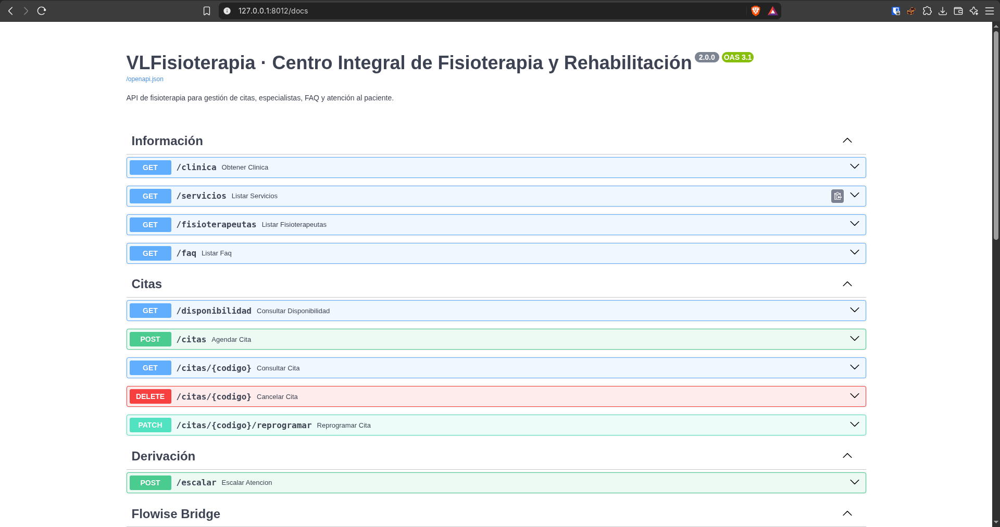
   - **Qué se probaba:** Visualización de los endpoints del negocio en `http://127.0.0.1:8012/docs` (secciones *Información*, *Citas*, *Derivación*, *Flowise Bridge* y *Compatibilidad*).
   - **Qué ocurrió:** La pagina abre la documentacion completa de todos los endpoints de la api y todo lo que se puede hacer con ella asi como especificaciones de lo que hace cada metodo en especifico
   - **Qué demuestra:** Que el servidor FastAPI expone el contrato OpenAPI completo y limpio sin las rutas de diapositivas eliminadas.

2. **Conversación multi-turno en Gradio**
   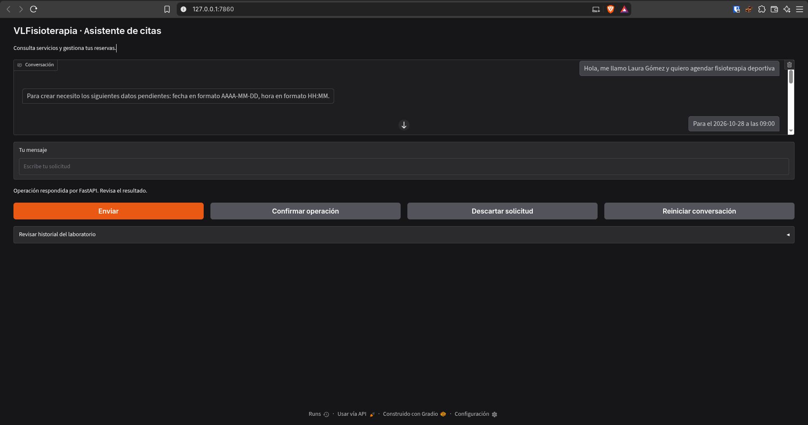
   - **Qué se probaba:** Solicitud de cita en varios turnos en `http://127.0.0.1:7860`, entregando primero nombre y servicio y en un turno posterior la fecha y la hora.
   - **Qué ocurrió:** El chatbot recuerda correctamente la informacion guarda la informacion que ya tiene y pide la que le hace falta al completar todo los campos no vuelve a preguntar por cosas que ya sabe
   - **Qué demuestra:** Que `chatbot_memoria.py` envía el historial acumulado a Groq y recuerda los datos de mensajes anteriores.

3. **Resumen previo y solicitud pendiente de confirmación en Gradio**
   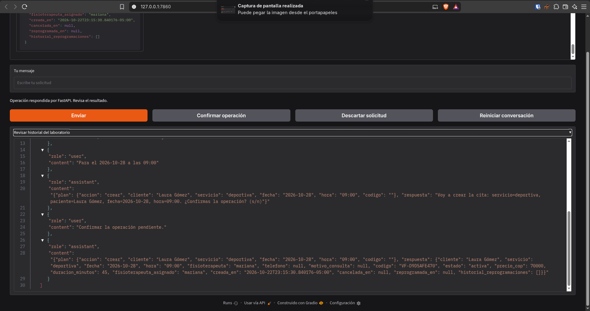
   - **Qué se probaba:** Que antes de escribir en SQLite el chatbot muestre el resumen de la operación y active el aviso `"Revisa el resumen y confirma o descarta."` junto al acordeón JSON del historial.
   - **Qué ocurrió:** El chatbot espera correctamente hasta que en la conversacion se pulse el boton de confirmar la operacion para registrarla en el sistema
   - **Qué demuestra:** Que `ejecutar(plan, confirmar=False)` detiene la operación de escritura hasta que el paciente pulse **Confirmar operación**.

4. **Reserva confirmada en Gradio con código `VF-...`**
   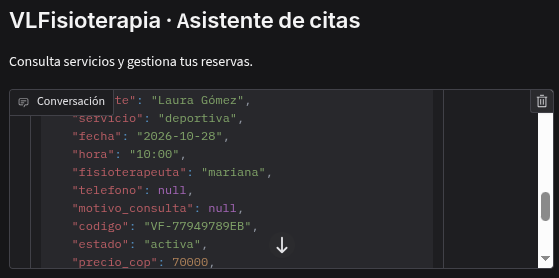
   - **Qué se probaba:** Ejecución efectiva de `POST /citas` al pulsar el botón **Confirmar operación** en Gradio.
   - **Qué ocurrió:** Al confirmar el chatbot ejecuta correctamente y guarda finalmente la reserva correctamente asignando asi tambien el codigo de este ejemplo "VF-77949789EB"
   - **Qué demuestra:** Que `confirmar(estado)` invoca `ejecutar(plan, confirmar=True)` y muestra al paciente los datos devueltos por FastAPI.

5. **Verificación de la fila guardada en SQLite (`reservas.db`)**
   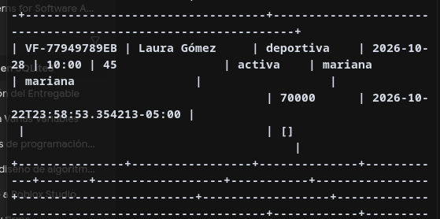
   - **Qué se probaba:** Consulta directa sobre `reservas.db` para verificar que la cita confirmada en Gradio quedó grabada en la tabla `reservas`.
   - **Qué ocurrió:** Aqui de igual forma se puede ver como en la base de datos reservas.db se guarda en la tabla toda la informacion que corresponde a la anterior reserva que se realizo y coincide con el codigo "VF-77949789EB"
   - **Qué demuestra:** La correspondencia exacta entre el código `VF-...` entregado en la interfaz de Gradio y el registro persistido en SQLite.

6. **Dos sesiones simultáneas en dos ventanas de navegador**
   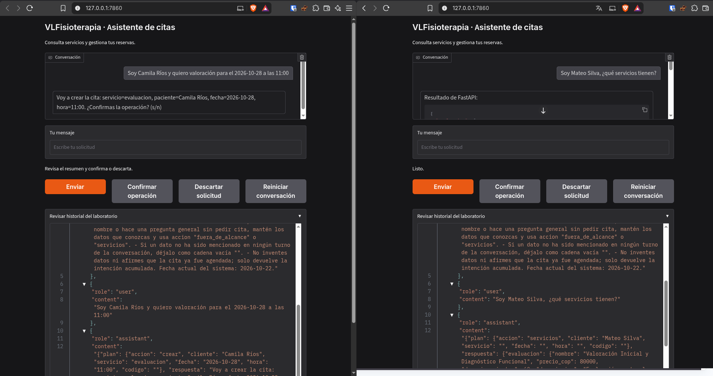
   - **Qué se probaba:** Abrir dos ventanas de navegador en `http://127.0.0.1:7860` conversando con datos de dos pacientes distintos en paralelo.
   - **Qué ocurrió:** Al usar el chatbot simultaneamente podemos ver que toda su informacion es independiente y sin errores de truncacion de datos por lo que se puede usar perfectamente sin que se cruze la informacion entre usuarios
   - **Qué demuestra:** Que `gr.State(value=nuevo_estado)` aísla el historial y las operaciones pendientes de cada sesión de usuario.

7. **Reinicio de conversación en Gradio sin borrar reservas**
   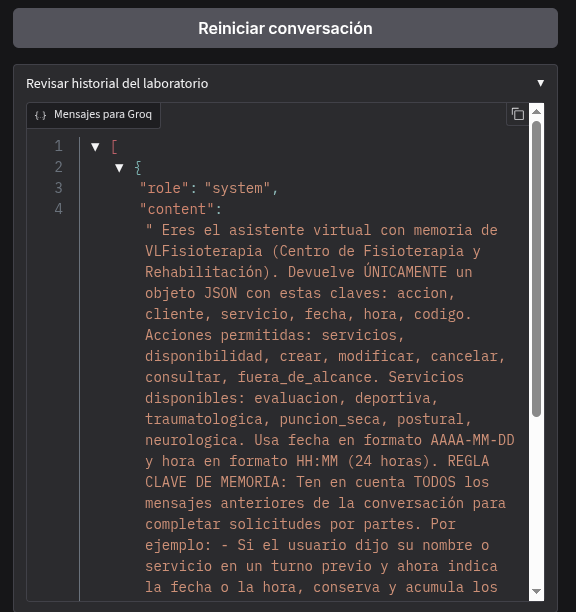
   - **Qué se probaba:** Pulsar **Reiniciar conversación** en una de las sesiones de Gradio y verificar el acordeón `"Mensajes para Groq"`.
   - **Qué ocurrió:** Al reiniciar la conversacion podemos ver que en el historial del laboratorio vuelve a estar por defecto limpiando la conversacion correctamente sin borrar ninguna reserva en la base de datos
   - **Qué demuestra:** Que el reinicio limpia la pantalla y deja solo el mensaje `system` en la sesión reiniciada sin borrar las reservas en `reservas.db`.

8. **Rechazo de intervalo ocupado en Gradio (`HTTP 409`)**
   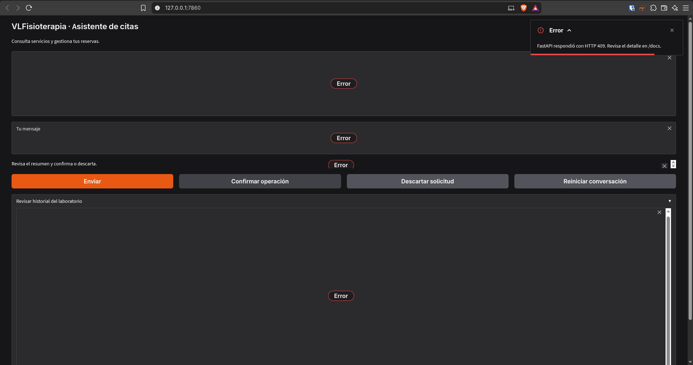
   - **Qué se probaba:** Intentar confirmar desde Gradio una cita en un horario que se cruza con otra reserva activa del mismo fisioterapeuta.
   - **Qué ocurrió:** Al intentar hacer una reserva en un horario que ya estaba pedido devuelve correctamente el codigo de error esperado (409)
   - **Qué demuestra:** Que FastAPI rechaza el cruce con `HTTP 409` y Gradio informa el problema mediante `gr.Error` permitiendo continuar la sesión.

9. **Cancelación de cita y persistencia tras reiniciar la API**
   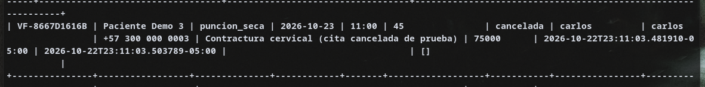
   - **Qué se probaba:** Cancelar una cita desde Gradio (o terminal), reiniciar el servidor FastAPI y comprobar que la fila sigue en SQLite con `estado='cancelada'`.
   - **Qué ocurrió:** Al cancelar la cita podemos ver que la fila sigue existiendo en la base de datos con el estado cancelado
   - **Qué demuestra:** Que la cancelación libera disponibilidad y conserva la fila en `reservas.db` después de reiniciar el servidor.

10. **Manejo de error controlado en la interfaz de Gradio**
    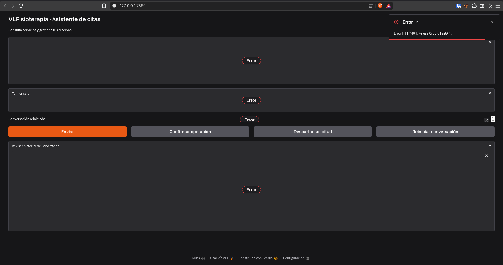
    - **Qué se probaba:** Provocar un error controlado en Gradio (enviar mensaje vacío, intentar enviar teniendo una confirmación pendiente, o consultar un código inexistente `VF-NOEXISTE99`).
    - **Qué ocurrió:** Al probar consultar un codigo que no existe obtenemos el codigo esperado (404) indicando que la API no encontro ninguna reserva relacionada a el codigo enviado en la peticion
    - **Qué demuestra:** Que `app_gradio.py` captura `HTTPError`, `URLError` y errores de validación, mostrando un aviso claro al usuario sin bloquear ni cerrar la aplicación.

---

## 11. Comparación con la versión del Primer Corte (Flowise + JSON vs. Python + Gradio + SQLite)

### 11.1 Tabla comparativa de arquitectura y componentes

| Dimensión | Versión del Primer Corte (Flowise + JSON) | Versión del Segundo Corte (Python + Gradio + SQLite) |
|---|---|---|
| **Orquestación del LLM** | Nodos visuales en **Flowise** (contenedor Docker en puerto 3000) con `puente_flowise.js` como Custom Tool. | Código Python nativo en [`consulta_llm.py`](../consulta_llm.py) y [`chatbot_memoria.py`](../chatbot_memoria.py) consumiendo directamente `https://api.groq.com/openai/v1/chat/completions`. |
| **Interfaz de usuario** | Chat embebido de Flowise (sin control directo sobre botones de confirmación ni inspección en vivo del payload). | Interfaz web propia en **Gradio 6** ([`app_gradio.py`](../app_gradio.py), puerto 7860) con botones dedicados (*Enviar*, *Confirmar operación*, *Descartar*, *Reiniciar*) y visor JSON del historial. |
| **Memoria y sesiones** | Diccionario global `SESIONES` en el servidor (`main.py` `/chat`) indexado por `session_id` y memoria interna de Flowise. | Estado aislado por pestaña de navegador con `gr.State(value=nuevo_estado)` en Gradio y lista explícita `messages` (`[system, user, assistant]`). |
| **Mecanismo de confirmación** | El usuario debía escribir literalmente la palabra `CONFIRMAR` en el chat (`/chat`). | El módulo `ejecutar(plan, confirmar=False)` retiene el plan en `estado["pendiente"]` y la escritura solo se dispara al pulsar el botón **Confirmar operación** (`confirmar=True`). |
| **Persistencia de reservas** | Archivo plano `citas.json` reescrito completo en cada cambio mediante archivo temporal `.tmp` y `os.replace`. | Base de datos relacional **SQLite** ([`reservas.db`](../reservas.db)) administrada por `AgendaSQLite` ([`almacen_sqlite.py`](../almacen_sqlite.py)) con tabla `reservas` de 16 columnas e índices. |
| **Concurrencia y cruces** | `threading.RLock` en memoria de un solo proceso y recorrido secuencial de listas JSON en memoria. | Transacciones SQLite con **`BEGIN IMMEDIATE`** combinadas con validación SQL parametrizada de cruces de intervalos por `fisioterapeuta_asignado`. |

### 11.2 Qué responsabilidades asumió el equipo directamente en el código Python
Al prescindir de Flowise y del archivo `citas.json`, el equipo asumió en su propio código Python seis responsabilidades técnicas:
1. **Construcción del payload HTTP y manejo de credenciales (`consulta_llm.py`):** Armar las cabeceras (`Authorization: Bearer ...`, `Content-Type: application/json`), cargar `.env` de forma segura y serializar `{"model": ..., "messages": ..., "stream": False}`.
2. **Parseo defensivo y normalización de la salida del LLM (`extraer_json` y `normalizar_servicio`):** Limpiar bloques Markdown ```` ```json ```` que el modelo pudiera añadir, validar que la clave `accion` pertenezca al conjunto cerrado `ACCIONES` y traducir sinónimos clínicos (`MAPA_SERVICIOS`) antes de llamar a la API.
3. **Administración manual del historial multi-turno (`chatbot_memoria.py`):** Inyectar la fecha actual en el prompt `system` y concatenar en cada turno los pares `user` / `assistant` (incluyendo el JSON del `plan` previo) para que el modelo conserve los datos entregados en mensajes anteriores.
4. **Control del flujo de confirmación y aislamiento de sesiones (`app_gradio.py`):** Bloquear nuevos envíos mientras exista un plan en `estado["pendiente"]`, ejecutar la escritura únicamente cuando `confirmar(estado)` invoca `ejecutar(plan, confirmar=True)` y limpiar el historial con `reiniciar()` sin tocar SQLite.
5. **Cálculo matemático de intervalos y agendas por especialista (`almacen_sqlite.py`):** Validar días de apertura, horarios diferenciados de lunes a viernes (`07:00–19:00`) y sábados (`08:00–14:00`), pasos de 30 minutos, duraciones de 45 y 60 minutos y solapamientos `inicio < fin_existente and fin_nuevo > inicio_existente` por fisioterapeuta.
6. **Transaccionalidad relacional y traducción de errores (`BEGIN IMMEDIATE` y `responder`):** Garantizar que la consulta de disponibilidad previa al guardado y el `INSERT`/`UPDATE` ocurran dentro de la misma transacción `BEGIN IMMEDIATE`, y mapear cada excepción del dominio (`CitaCancelada`, `ReservaNoEncontrada`, `ConflictoReserva`, `ValueError`, `sqlite3.Error`) a códigos HTTP estándar (`400`, `404`, `409`, `422`, `503`).

---

## 12. Limitaciones actuales y mejoras pendientes

### 12.1 Limitaciones conocidas de la versión actual
1. **Parche global de IPv4 (`socket.getaddrinfo`) en `consulta_llm.py`:** Para evitar timeouts de IPv6 y bloqueos de Cloudflare al conectar con `api.groq.com` desde Linux, se sobrescribe `socket.getaddrinfo` en el proceso cliente. Aunque resuelve el problema práctico en el laboratorio, modifica el comportamiento global de resolución DNS del proceso.
2. **Historial conversacional volátil en el navegador (`gr.State`):** Los mensajes del chat no se persisten en SQLite; si el paciente recarga la página del navegador, la conversación se reinicia (aunque sus citas ya confirmadas en `reservas.db` permanecen seguras).
3. **Envío íntegro del historial en cada turno:** `interpretar_turno()` envía todos los mensajes acumulados de la sesión en cada llamada a Groq; en conversaciones de decenas de turnos aumentaría el consumo de tokens.
4. **Coexistencia de dos contratos de chat (`/chat` heredado vs. `app_gradio.py`):** `main.py` conserva el endpoint `/chat` y las rutas `/api/*` para no romper las pruebas de regresión heredadas del primer corte, aunque la interfaz principal del segundo corte (`app_gradio.py`) consume directamente las rutas REST (`/servicios`, `/disponibilidad`, `/citas`).
5. **Selección de fisioterapeuta desde el extractor del LLM:** Aunque FastAPI y `AgendaSQLite` soportan elegir fisioterapeuta (`mariana`, `carlos`, `valeria`) y asignan automáticamente al primer especialista habilitado y libre cuando no se especifica, el esquema de 6 campos de `consulta_llm.py` (`accion, cliente, servicio, fecha, hora, codigo`) delega la asignación automática al backend en lugar de extraer el nombre del fisioterapeuta como séptimo campo.

### 12.2 Mejoras propuestas para una siguiente versión
- Añadir el campo opcional `fisioterapeuta` al esquema JSON de `consulta_llm.py` para que el paciente también pueda pedir desde Gradio un especialista específico por su nombre.
- Implementar una ventana deslizante en `chatbot_memoria.py` (conservando siempre el mensaje `system` y los últimos $N$ turnos, más el último `plan` acumulado).
- Persistir una tabla opcional `sesiones_chat` en SQLite para auditoría de conversaciones sin mezclarla con la tabla transaccional `reservas`.
