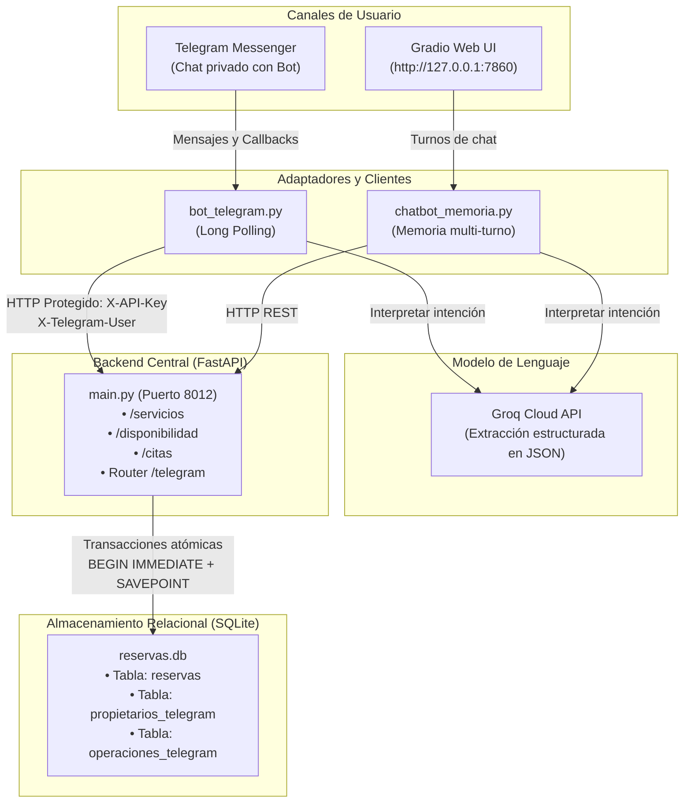
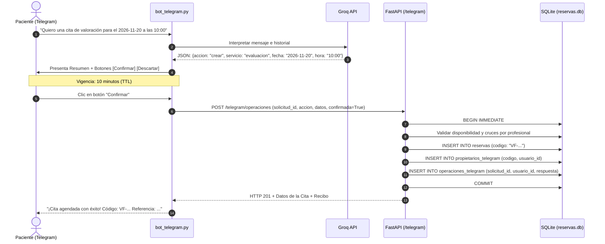

# Guía Integral del Proyecto · VLFisioterapia

Esta guía está diseñada para cualquier integrante del equipo, docente o evaluador que desee comprender cómo funciona el sistema VLFisioterapia, su arquitectura, sus límites clínicos y la operación paso a paso de sus canales conversacionales (Gradio Web y Telegram).

---

## 1. Qué es VLFisioterapia y qué problema resuelve

**VLFisioterapia · Centro Integral de Fisioterapia y Rehabilitación** es un sistema integral de atención y gestión de citas médicas para una clínica de fisioterapia ficticia ubicada en Armenia, Quindío.

### El problema que resuelve
Tradicionalmente, agendar o reprogramar una cita de fisioterapia requiere llamadas telefónicas o mensajes manuales donde el personal de recepción debe verificar la disponibilidad de varios especialistas con agendas distintas, duraciones variables de tratamiento (45 o 60 minutos) y horarios semanales específicos. Esto genera demoras, errores humanos en cruces de citas y duplicación de reservas.

VLFisioterapia automatiza este proceso las 24 horas del día a través de dos canales conversacionales (Web interactiva con Gradio y mensajería móvil con Telegram). El sistema interpreta lenguaje natural mediante inteligencia artificial (Groq LLM), pero **delega toda la validación de negocio, disponibilidad y almacenamiento en una base de datos relacional (SQLite) protegida por transacciones atómicas**.

---

## 2. Qué puede hacer el chatbot y qué no debe hacer (Límites clínicos)

### ✅ Lo que SÍ puede hacer el asistente
- Informar sobre el catálogo de tratamientos fisioterapéuticos, sus objetivos clínicos, duración en minutos y tarifas en pesos colombianos (COP).
- Informar sobre horarios de atención semanal de la clínica (Lunes a Sábado), ubicación y convenios de seguros de salud (SURA, Colmédica, Seguros Bolívar, Sanitas y particulares).
- Consultar la disponibilidad real de turnos libres para una fecha y servicio específico, considerando los tres fisioterapeutas de la clínica (`mariana`, `carlos`, `valeria`).
- Preparar propuestas de agendamiento, modificación y cancelación de citas médicas.
- Exigir confirmación explícita mediante botones interactivos antes de ejecutar cualquier cambio en la base de datos.
- Asociar cada cita creada en Telegram al usuario que la solicitó para impedir accesos o modificaciones ajenas.
- Recuperar recibos de operaciones en caso de intermitencia de red (idempotencia y tolerancia a fallos).
- Transferir al paciente a recepción médica humana (`/escalar` o derivación a WhatsApp/teléfono).

### ❌ Lo que NO debe hacer (Límites clínicos estrictos)
- **No diagnostica enfermedades ni patologías:** No reemplaza la valoración médica presencial de un profesional de la salud.
- **No prescribe medicamentos ni tratamientos farmacológicos:** El ámbito de la fisioterapia es físico, biomecánico y funcional.
- **No atiende urgencias médicas hospitalarias vitales:** Ante traumatismos agudos no inmovilizados, fracturas expuestas o dolor torácico, orienta al paciente hacia un servicio de urgencias hospitalarias.
- **No decide disponibilidad por sí mismo:** El modelo de lenguaje (LLM) solo extrae datos; nunca decide si hay cupo ni confirma citas sin pasar por la API y SQLite.

---

## 3. Cómo funciona el proyecto de principio a fin

El ciclo de vida de un mensaje sigue este flujo exacto:

1. **Mensaje del paciente:** El paciente escribe en Telegram ("*Deseo agendar una valoración para el próximo lunes a las 10:00*") o en la interfaz web de Gradio.
2. **Recepción en el canal:** 
   - En **Telegram** (`bot_telegram.py`), el mensaje es capturado por un manejador de texto en un chat privado.
   - En **Gradio** (`app_gradio.py`), el mensaje entra por la función `enviar()`.
3. **Interpretación con Groq LLM:** El mensaje se envía a Groq junto con las instrucciones del sistema y la fecha actual en zona horaria `America/Bogota`. El LLM devuelve un JSON estructurado con la intención (`crear`, `modificar`, `cancelar`, `servicios`, `disponibilidad`, `fuera_de_alcance`) y los campos extraídos (`cliente`, `servicio`, `fecha`, `hora`, `codigo`).
4. **Validación en la API (FastAPI en `main.py`):**
   - Si es lectura (catálogo o disponibilidad), consulta la agenda y retorna los horarios libres.
   - Si es escritura, el bot presenta primero un **resumen inequívoco** con botones interactivos (**Confirmar** y **Descartar**).
5. **Confirmación explícita:** El paciente presiona **Confirmar**.
6. **Ejecución atómica en `AgendaTelegram` (`almacen_sqlite.py` / `api_telegram.py`):**
   - Se inicia una transacción inmediata en SQLite (`BEGIN IMMEDIATE`).
   - Se verifica que el turno siga libre para el especialista correspondiente y que la huella previa no haya cambiado.
   - Se inserta la cita en la tabla `reservas`.
   - Se vincula el código de cita con el `usuario_id` en la tabla `propietarios_telegram`.
   - Se registra el recibo en `operaciones_telegram` con su identificador único de solicitud (`solicitud_id`).
   - Se confirma la transacción (`COMMIT`).
7. **Respuesta al paciente:** El paciente recibe el código de cita generado (ej: `VF-1234567890`), los datos confirmados y la referencia de la operación.

---

## 4. Qué papel tiene cada archivo y carpeta importante

```text
chatbot-fisioterapia-x/
├── clinica.json                 # Catálogo oficial: 6 tratamientos, tarifas COP, 3 fisioterapeutas, horarios y políticas.
├── main.py                      # Servidor FastAPI principal: endpoints REST de citas, servicios, Gradio bridge y router /telegram.
├── almacen_sqlite.py            # Clase AgendaSQLite: lógica central de intervalos, duraciones, cruces por fisio y SQLite.
├── api_telegram.py              # Clase AgendaTelegram: añade propietarios_telegram, operaciones_telegram, savepoints y router /telegram.
├── bot_telegram.py              # Adaptador de Telegram: long polling, comandos, botones inline de confirmación y cliente HTTP.
├── simular_respuesta_perdida.py # Herramienta de laboratorio para probar el escenario T24 (timeout fingido tras guardar).
├── chatbot_memoria.py           # Gestor de memoria conversacional multi-turno para el canal web.
├── consulta_llm.py              # Cliente de conexión hacia la API de Groq y normalizador de intenciones.
├── app_gradio.py                # Interfaz gráfica web interactiva desarrollada con Gradio 6.
├── reservas.db                  # Base de datos relacional SQLite con tablas de citas, propietarios y recibos.
├── requirements.txt             # Dependencias principales de Python del proyecto.
├── requirements_telegram.txt    # Dependencias específicas para el canal de Telegram.
├── test_telegram.py             # Suite automatizada de pruebas para el canal de Telegram (T01 a T25).
├── probar_fisioterapia.py       # Suite de pruebas unitarias de la agenda de fisioterapia.
├── test_integracion_completa.py # Prueba de integración extremo a extremo con Groq real.
└── docs/
    ├── clase_13/
    │   ├── GUIA_DEL_PROYECTO.md       # Este documento: explicación conceptual y funcional completa.
    │   ├── CONFIGURACION_TELEGRAM.md  # Instrucciones paso a paso para credenciales, .env y ejecución en Linux.
    │   ├── Matriz_25_Pruebas.md       # Resultados y evidencias de los escenarios T01–T25.
    │   ├── Bitacora_Clase_13.md       # Bitácora formal de la sesión siguiendo el estándar del curso.
    │   └── evidencias/                # Registros de ejecución y salidas reales sanitizadas.
    └── bitacoras_previas/             # Bitácoras históricas de las sesiones C01 a C04 (inalteradas).
```

---

## 5. Cómo se conectan Telegram, Gradio, FastAPI, Groq y SQLite



---

## 6. Diferencia entre Código de Cita y Referencia de Operación

En el sistema existen dos identificadores distintos con finalidades diferentes:

| Identificador | Formato de ejemplo | Propósito | ¿Dónde se usa? |
|---|---|---|---|
| **Código de Cita** | `VF-886DE6796E` | Identifica la **cita médica en la agenda del negocio**. Permanece igual durante toda la vida de la cita (incluso al reprogramarse). | `/reserva VF-886DE6796E`, consultar estado de la cita médica, cancelar o reprogramar. |
| **Referencia de Operación** (`solicitud_id`) | `a1b2c3d4e5f6...` (32 caracteres hex) | Identifica una **transacción o intento específico de escritura** (crear, modificar o cancelar). Es un UUID v4 generado antes de confirmar. | `/estado [REFERENCIA]`, `/reintentar`, prevención de pagos/reservas duplicadas (idempotencia). |

---

## 7. Confirmación, propiedad por usuario y recuperación incierta

### Confirmación explícita
Ningún texto del usuario ni interpretación del LLM puede agendar o modificar una cita directamente. El bot construye una propuesta con un temporizador de 10 minutos y muestra dos botones:
- **Confirmar:** Envía la solicitud firmada a la API con `confirmada: True`.
- **Descartar:** Elimina la propuesta de la memoria sin realizar cambios en la base de datos.

### Propiedad por usuario
Cada cita creada desde Telegram queda registrada en la tabla `propietarios_telegram` con el `usuario_id` del remitente (obtenido directamente desde `update.effective_user.id`).
- Si otro usuario intenta consultar, modificar o cancelar esa cita conociendo el código, la API devuelve **HTTP 404 ("Reserva no disponible para este usuario")**, sin revelar siquiera si el código existe.
- Las citas históricas creadas desde Gradio o la API no tienen propietario de Telegram registrado; por seguridad, no pueden ser manipuladas desde Telegram hasta contar con una vinculación verificada.

### Recuperación de operación incierta (T24)
Si el bot envía la confirmación de una cita a FastAPI, la base de datos guarda la cita y emite el recibo, pero una caída de red o un timeout interrumpe la respuesta antes de que llegue al bot:
1. El bot no asume que la operación falló; marca la propuesta como **incierta** y conserva su identificador.
2. El bot prohíbe crear nuevas solicitudes hasta verificar el estado.
3. El usuario escribe `/estado` (o `/estado <REFERENCIA>`).
4. El bot consulta `GET /telegram/operaciones/{solicitud_id}`.
5. FastAPI devuelve el recibo persistido en `operaciones_telegram`.
6. El bot recupera el resultado exitoso y entrega el código `VF-...` al paciente **sin duplicar la reserva en SQLite**.

---

## 8. Diagrama de flujo de agendamiento



---

## 9. Qué se configura manualmente y por qué

Existen configuraciones que **nunca deben almacenarse en repositorios de código ni compartirse con terceros**:
1. `TELEGRAM_BOT_TOKEN`: El token secreto entregado por `@BotFather`. Identifica la cuenta del bot ante los servidores oficiales de Telegram.
2. `CHATBOT_API_KEY`: Una clave privada de al menos 16 caracteres ASCII generada por el equipo (`secrets.token_urlsafe(32)`). Permite que FastAPI autentique que quien llama a `/telegram` es el proceso legítimo del bot y no un actor malicioso externo.
3. `GROQ_API_KEY`: La clave de acceso a Groq Cloud para el modelo LLM.

Estas variables se configuran en un archivo `.env` local (con permisos de lectura restringidos `chmod 600 .env`) que se encuentra estrictamente excluido por `.gitignore`.

---

## 10. Cómo arrancar y detener el proyecto

### Requisitos previos
- Sistema operativo Linux (o macOS/Windows con entorno Bash).
- Python 3.11 a 3.13 con entorno virtual `.venv` activado.

### Terminal 1: Iniciar el backend FastAPI
```bash
cd /home/victorsheen/chatbot-fisioterapia-x
source .venv/bin/activate
uvicorn main:app --host 127.0.0.1 --port 8012 --reload
```
*La API iniciará en `http://127.0.0.1:8012`. La documentación Swagger estará lista en `http://127.0.0.1:8012/docs`.*

### Terminal 2: Iniciar el Bot de Telegram
```bash
cd /home/victorsheen/chatbot-fisioterapia-x
source .venv/bin/activate
python bot_telegram.py
```
*El bot iniciará el long polling y mostrará: `Bot de VLFisioterapia en ejecución por polling...`.*

### Detener los servicios
Presiona `Ctrl + C` en cada una de las terminales para detener los procesos de forma limpia y ordenada.

---

## 11. Cómo comprobar que cada componente funciona

1. **Comprobar la API y Swagger:** Abre `http://127.0.0.1:8012/docs` en tu navegador. Verifica que aparezcan los endpoints agrupados bajo el tag `Telegram` (`/telegram/servicios`, `/telegram/disponibilidad`, `/telegram/reservas/{codigo}`, `/telegram/operaciones`).
2. **Ejecutar la suite automatizada del canal:**
   ```bash
   .venv/bin/python test_telegram.py
   ```
   *Debe reportar: `¡TODAS LAS PRUEBAS DEL CANAL TELEGRAM PASARON EXITOSAMENTE (100% OK)!`.*
3. **Ejecutar las pruebas unitarias y de integración previa:**
   ```bash
   .venv/bin/python probar_fisioterapia.py
   .venv/bin/python test_integracion_completa.py
   ```
   *Ambas suites deben pasar al 100%.*

---

## 12. Errores frecuentes y cómo resolverlos

| Síntoma observado | Causa más probable | Solución |
|---|---|---|
| `HTTP 401: Acceso del servicio no autorizado` | La clave `CHATBOT_API_KEY` en el bot no coincide con la configurada en la API. | Verifica que ambas terminales compartan exactamente el mismo valor de `CHATBOT_API_KEY` en `.env`. |
| `HTTP 503: Canal Telegram deshabilitado` | `CHATBOT_API_KEY` no fue definida en el entorno al iniciar `main.py`. | Agrega `CHATBOT_API_KEY=...` a `.env` y reinicia el proceso de `uvicorn`. |
| `Conflict: terminated by other getUpdates request` | Hay dos procesos del bot corriendo simultáneamente con el mismo token. | Detén cualquier otro script de `bot_telegram.py` o simulador antes de volver a arrancar. Solo se permite un proceso de polling por token. |
| `Reserva no disponible para este usuario (404)` | Estás intentando consultar una cita creada por otra persona o una cita histórica de Gradio. | Solo puedes consultar citas creadas desde tu misma cuenta de Telegram. Crea una nueva cita para probar. |
| `La reserva cambió. Consúltala y prepara otro resumen (409)` | La cita fue alterada en la base de datos entre el momento en que pediste reprogramar y el clic en Confirmar. | Vuelve a consultar la cita con `/reserva CODIGO` y prepara una nueva propuesta con la referencia actualizada. |

---

## 13. Limitaciones conocidas y trabajo futuro

1. **Vinculación de cuentas históricas:** Actualmente las citas creadas en la interfaz web de Gradio no se pueden consultar desde Telegram porque no existe un número de teléfono o correo validado que vincule la cuenta de Telegram con el paciente de la web. En una siguiente fase se puede implementar un código OTP por SMS o WhatsApp para asociar citas previas.
2. **Recordatorios proactivos (Push Notifications):** El bot opera en modo reactivo por long polling. Para enviar recordatorios automáticos 24 horas antes de la cita, se requiere implementar una tarea en segundo plano (cron/scheduler) que invoque la API de Telegram.
3. **Pagos en línea:** Las tarifas en COP se informan de manera clara y transparente, pero el recaudo se realiza en recepción o mediante transferencia bancaria; una pasarela de pagos integrada (Wompi/PSE) sería el siguiente paso de evolución comercial.
